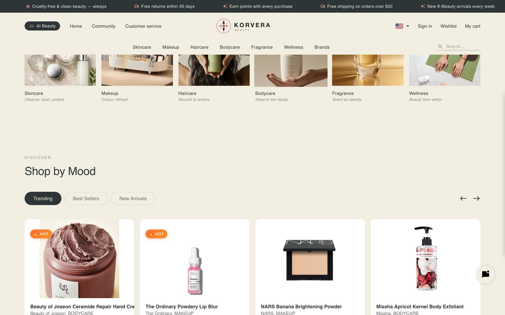
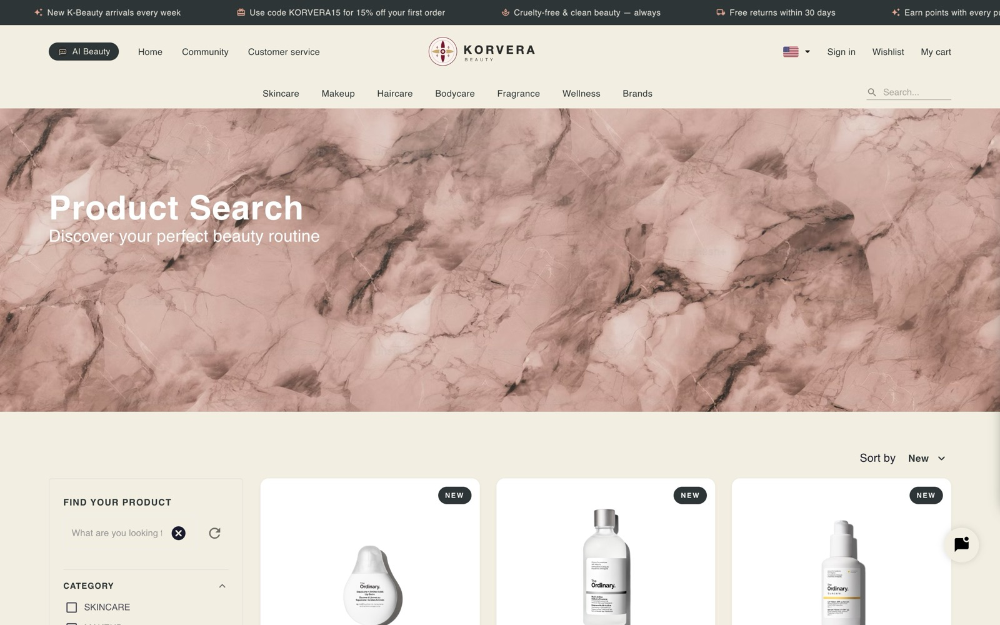

# Korvera

**Live:** [korvera.kr](https://korvera.kr)

Frontend for [korvera.kr](https://korvera.kr), a K-beauty marketplace. Shoppers browse by skin type rather
than by brand, sellers run their own storefronts, and the whole catalogue is
available in English, Korean and Russian.





## Tech Stack

| Layer | Technology |
|---|---|
| Framework | Next.js (Pages Router) + TypeScript |
| UI | Material UI 5 + SCSS |
| Data | Apollo Client (GraphQL), WebSocket subscriptions |
| Auth | JWT with silent refresh (`apollo-link-token-refresh`) |
| 3D | react-three-fiber + drei |
| Editor | Toast UI Editor |
| Charts | Chart.js |
| i18n | next-i18next — EN, KR, RU |

## Features

- Catalogue across six categories (skincare, makeup, haircare, bodycare,
  fragrance, wellness) with filters for skin type, shade and size
- Beauty quiz that narrows the catalogue to the shopper's own skin type
  (normal, dry, oily, combination, sensitive)
- Cart, checkout and order tracking
- Seller profiles, each managing their own listings
- Community boards with comments and likes
- Real-time chat and notifications over WebSocket
- Admin panel: members, products, orders, community, notices, FAQ
- Image compression in the browser before upload, so phone photos do not
  arrive at 8 MB

## Getting Started

```bash
git clone https://github.com/gaspiralli97/korvera-next.git
cd korvera-next
npm install
cp .env.example .env.development
npm run dev
```

Needs the Korvera GraphQL API running. `REACT_APP_API_URL`, `REACT_APP_API_GRAPHQL_URL` and `REACT_APP_API_WS` point at it.

## Scripts

| Command | What it does |
|---|---|
| `npm run dev` | Development server |
| `npm run build` | Production build |
| `npm start` | Serve the production build |
| `npm run lint` | ESLint |

## Project Layout

```
pages/        routes — product, seller, cart, checkout, order,
              community, cs, mypage, quiz, _admin
libs/
  components/ feature components grouped by page
  auth/       JWT storage and login
  enums/      shared enums, mirrored from the API
  types/      GraphQL response types
apollo/       Apollo client, links, store
scss/         global styles
```
